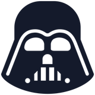

<div align="center">

<picture>
  <source media="(prefers-color-scheme: dark)" srcset="docs/brand/vader-light.png">
  
</picture>

# Juan David Martínez Medina

**Desarrollador de Software · Portafolio 3D interactivo**

Una experiencia web con luz de estudio y noche, escenas guiadas por el scroll<br>
y proyectos que se descubren detrás de puertas en 3D.

[](https://portfolio-jdmm.vercel.app/)


[LinkedIn](https://www.linkedin.com/in/juan-david19/) &nbsp;·&nbsp; [GitHub](https://github.com/Juandamm01) &nbsp;·&nbsp; [juandamm099@gmail.com](mailto:juandamm099@gmail.com)

</div>

<br>

<p align="center">
  
</p>

---

## Sobre el proyecto

Soy desarrollador de software con experiencia en el desarrollo de aplicaciones y soluciones tecnológicas. Me enfoco en construir sistemas funcionales, eficientes y bien estructurados, y participo en las distintas etapas del desarrollo: diseño de la solución, lógica de negocio, integración de servicios y construcción de interfaces.

Este portafolio es estático (Astro) y no envía ningún framework de UI al navegador: cada interacción es TypeScript ligero, las escenas 3D son CSS 3D y GSAP solo se descarga en escritorio.

---

## Características principales

<table>
  <tr>
    <td width="50%" valign="top">
      <h3>💡 Luz de estudio / noche</h3>
      Una cuerda junto al selector de idioma cambia el tema de todo el sitio con una simulación física (tensión, liberación y oscilación). La nueva luz aparece como un círculo que crece desde la cuerda.
    </td>
    <td width="50%" valign="top">
      <h3>🚪 Proyectos detrás de puertas</h3>
      Puertas en CSS 3D con madera pintada, herrajes de bronce y luz por la rendija. Al entrar, la puerta se abre, la cámara avanza y la página del proyecto recibe la imagen con una <i>view transition</i>.
    </td>
  </tr>
  <tr>
    <td valign="top">
      <h3>🎬 Escenas guiadas por el scroll</h3>
      «Sobre mí» entra, gana profundidad y se desplaza; las etapas de desarrollo son planos en profundidad que la cámara recorre. Sin secuestrar el scroll.
    </td>
    <td valign="top">
      <h3>🕰️ Trayectoria con odómetro</h3>
      El año gira como un odómetro según la experiencia activa, con profundidad entre entradas. También en móvil, como barra fija compacta.
    </td>
  </tr>
  <tr>
    <td valign="top">
      <h3>🌐 Español e inglés</h3>
      Rutas estáticas <code>/</code> y <code>/en/</code> desde una sola plantilla, con la elección recordada y sin parpadeos de traducción.
    </td>
    <td valign="top">
      <h3>📱 Responsive de verdad</h3>
      En móvil el scroll vertical recorre las puertas una por una, las escenas pasan a versiones ligeras y nada se desborda horizontalmente.
    </td>
  </tr>
</table>

---

## Capturas

| Luz de estudio | Luces apagadas |
| :---: | :---: |
|  |  |
| **Sobre mí** | **Etapas de desarrollo en 3D** |
|  |  |
| **Trayectoria** | **Proyectos** |
|  |  |

<p align="center"><b>Página de proyecto</b></p>
<p align="center">
  
</p>

<p align="center"><b>Móvil</b></p>
<p align="center">
  
  &nbsp;
  
  &nbsp;
  
</p>

---

## Proyectos destacados

| Proyecto | Qué es | Enlace |
| --- | --- | --- |
| 🏆 **Comunidad Protegida** | Plataforma de orientación para jóvenes. Primer lugar, Hackatón de Villavicencio 2026. | [gobernacionreto.vercel.app](https://gobernacionreto.vercel.app/) |
| **Dra. Camila Henao** | Sitio web y panel administrativo para una clínica odontológica. | [Visitar](https://dra-camila-henao-web.vercel.app/) |
| **Bioconstructores Asociados** | Sitio web y dashboard administrativo. | [Visitar](https://bcas-iqax.vercel.app/) |
| **DriveDen** | Aplicación móvil para la gestión de vehículos. | [driveden.online](https://driveden.online/) |
| **Papelería M&M** | Landing page para un emprendimiento familiar. | [Visitar](https://papeleria-m-m-ten.vercel.app/) |

---

## Stack

<p align="center">
  
</p>

| Herramienta | Uso en el proyecto |
| --- | --- |
| **Astro 6** | Páginas estáticas, optimización de imágenes (AVIF/WebP) y rutas por idioma. |
| **TypeScript** | Toda la interacción del cliente, sin framework de UI. |
| **CSS 3D + `@property`** | Puertas, prisma de palabras, retrato con profundidad y transición de colores entre temas. |
| **GSAP + ScrollTrigger** | Escenas de «Sobre mí», etapas de desarrollo y salida del footer (solo escritorio). |
| **View Transitions API** | Paso de la puerta a la página del proyecto y revelado circular del cambio de luz. |
| **Fontsource** | Schibsted Grotesk e Instrument Serif servidas desde el propio sitio. |

---

## Rendimiento y accesibilidad

- **~6 KB de JavaScript (gzip)** en la carga inicial; GSAP (~46 KB gzip) se descarga solo en escritorio.
- Sin componentes hidratados ni canvas: las escenas 3D usan únicamente `transform` y `opacity`.
- Respeta `prefers-reduced-motion`: las escenas pasan a un flujo normal y las animaciones se desactivan.
- Efectos reducidos automáticamente en equipos con pocos recursos (núcleos/memoria).
- Navegación completa con teclado: foco visible, puertas que se abren al enfocarlas y enlaces reales.
- Textos alternativos, etiquetas ARIA y contenido equivalente para lectores de pantalla en los elementos animados.

---

## Estructura

```text
src/
├── pages/
│   ├── [...lang].astro            # Inicio: genera / y /en/
│   ├── proyectos/[slug].astro     # Páginas de proyecto (ES)
│   └── en/projects/[slug].astro   # Páginas de proyecto (EN)
├── layouts/BaseLayout.astro
├── components/
│   ├── layout/    # Cabecera, pie e iluminación del fondo
│   ├── sections/  # Hero, About, Process, Experience, Projects, ProjectDetail, Contact
│   └── ui/        # Retrato, cuerda, prisma de palabras, puerta, iconos
├── data/          # Perfil, experiencia y proyectos (ES/EN)
├── i18n/ui.ts     # Textos de la interfaz (ES/EN)
├── scripts/       # Cuerda, escenas, puertas, línea de tiempo, audio, cursor
├── styles/        # Tokens de diseño y estilos base
└── assets/        # Fotografías, logo y capturas de proyectos
```

---

## Ejecutar en local

> Requiere [Bun](https://bun.sh/).

```bash
bun install
bun run dev       # http://localhost:4321
bun run build     # genera dist/
bun run preview
```

Para añadir un proyecto, agrega una entrada en `src/data/projects.ts` y su captura en `src/assets/projects/`: la puerta y su página (en ambos idiomas) se generan solas.

---

<div align="center">

**Juan David Martínez Medina** · Villavicencio, Colombia

[LinkedIn](https://www.linkedin.com/in/juan-david19/) &nbsp;·&nbsp; [GitHub](https://github.com/Juandamm01) &nbsp;·&nbsp; [juandamm099@gmail.com](mailto:juandamm099@gmail.com)

</div>
